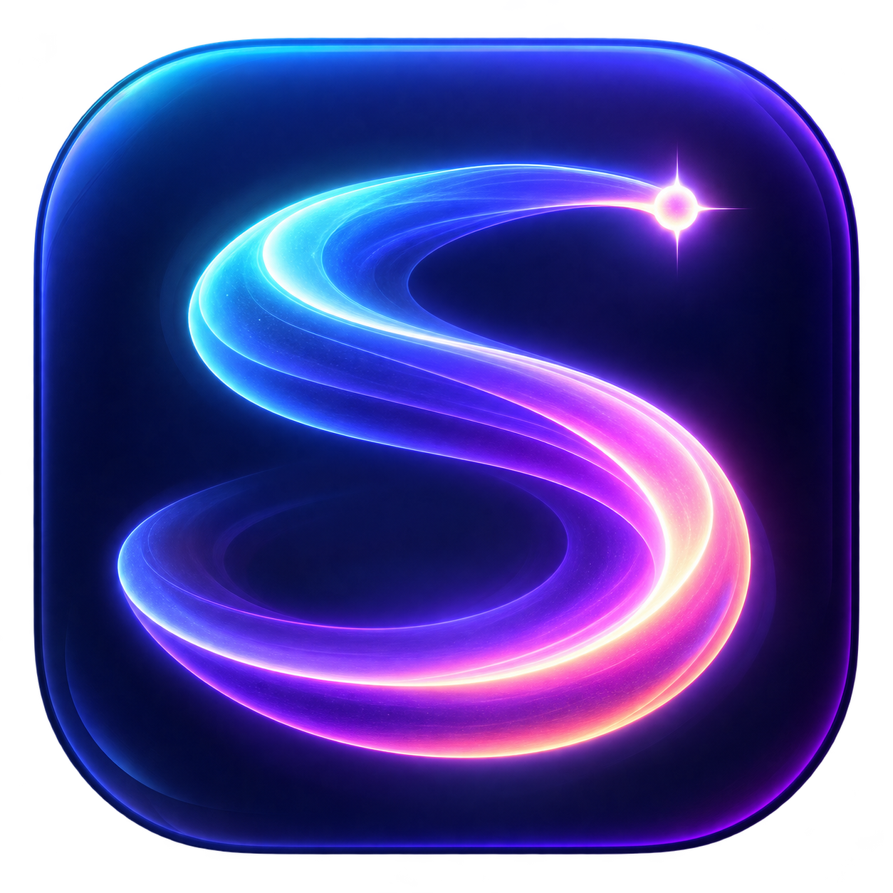
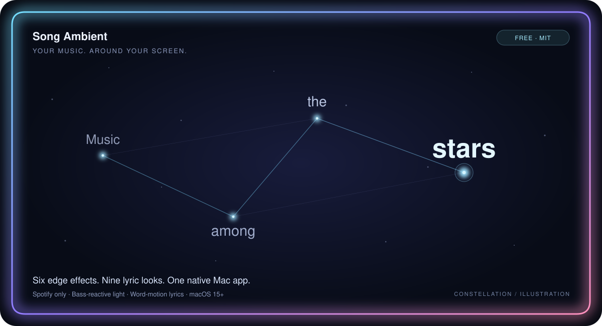

<div align="center">



# Song Ambient

### Your music. Around your screen.

**Free, open-source Spotify edge lighting and animated lyrics for macOS.**

An independent, MIT-licensed alternative to Lumn. No app subscription. No activation key.

[](LICENSE)
[](https://github.com/rachitkothadia/song-ambient/releases/latest)
[](Package.swift)
[](https://github.com/rachitkothadia/song-ambient/releases/latest)

[**Download for Apple silicon**](https://github.com/rachitkothadia/song-ambient/releases/latest) · [Build from source](#build-from-source) · [Report a bug](https://github.com/rachitkothadia/song-ambient/issues)



<sub>Constellation illustration. Actual colors, words and placement follow your settings and lyric data.</sub>

</div>

## Make your desktop part of the song

A bass hit should feel like a bass hit. Song Ambient analyzes Spotify audio on your Mac and turns it into light around your display. Open Lyrics Studio and let individual words fly, branch, bend, or connect into a constellation.

- **Spotify only.** A process inclusion tap captures Spotify and its helpers. WhatsApp, browser videos and other apps cannot drive the display rim. Paused or silent Spotify turns the live rim off.
- **Six border effects.** Aurora, Comet, **Waves**, Spectrum, Ribbons and Minimal have different silhouettes. Waves is back, with traveling crests and bass-driven bounce.
- **Bass with a little spring.** Separate bass, mid and treble analysis, sixteen frequency bands, onset detection and damped rebound drive the lighting.
- **Nine lyric looks.** Ship, Fisheye, Visual, Fisheye Visual, Codestyle, Codestyle Visual, Branches, Web and Constellation render individual words.
- **A constellation that wanders.** Words visit random star positions with curved travel, varied distances and directions, and glowing connections.
- **Hinglish display.** Hindi script is romanized into Latin characters; existing English and Latin text stays intact.
- **A native Mac companion.** Resizable studio, full-screen stage, optional desktop lyrics and a floating player. Close the studio to remove its Dock icon and keep it in the menu bar.
- **Make it yours.** Custom or album-derived colors, seven fonts, lyric size and offset, display selection, glow, thickness and motion controls. Custom palette and music sync start enabled on a fresh install.

## Six ways to light the edges

| Effect | What you see |
| --- | --- |
| **Aurora** | Broad, soft, irregular swells of light |
| **Comet** | A bright traveling head with a fading tail |
| **Waves** | Rolling, sharply outlined crests that react to the music |
| **Spectrum** | Separated bars driven by measured frequency bands |
| **Ribbons** | Three fine, separated flowing strands |
| **Minimal** | A restrained, quiet hairline |

## Get started

1. Download `SongAmbient-2.1.1-macOS-arm64.zip` from [Releases](https://github.com/rachitkothadia/song-ambient/releases/latest).
2. Unzip it, move `SongAmbient.app` into Applications, then open it.
3. Open **Spotify desktop** and play a track. Song Ambient connects and starts music sync automatically unless you disabled these settings.
4. Allow **Automation → Spotify** and **System Audio Recording** when macOS asks. The OS permission name is broad; the app's tap includes only Spotify processes.
5. Choose an edge effect, or open **Lyrics Studio** and launch the full-screen stage.

Requires **macOS 15 or newer** and Spotify desktop. The downloadable build is **Apple silicon only**, ad-hoc signed and **not Apple-notarized**. macOS may block a downloaded build: after verifying its source, use **System Settings → Privacy & Security → Open Anyway**, or build locally. No need to disable Gatekeeper globally.

Use **H** to hide/show stage controls and **Escape** to leave full screen. The menu bar orbit reopens the studio after you close it. Quit from its menu to stop the app completely.

## Honest timing, better words

Every style displays individual words, but the quality of synchronization depends on the recording's lyric data:

| Status | Meaning |
| --- | --- |
| **Word sync** | Real word timestamps from the provider or an imported file. Original timestamps and gaps are preserved. |
| **Word motion · estimated** | Only line or multiword segment timing is available. Words are visually paced within that interval; this is **not exact vocal alignment**. |
| **No timed lyrics** | No song text is invented. Try another recording or import a timed file. |

Recording selection is remembered for the current track. You can import UTF-8 enhanced LRC or Lyricsfile YAML; [the authored timing demo](Examples/Timing-Demo.lyricsfile.yaml) shows genuine word-level input. Estimated word timestamps are never written back to source data. An explicitly labeled demo lets you explore layouts without lyric availability.

Hindi romanization is approximate. LRCLIB coverage and recording matches vary. An optional, best-effort correction reads an unambiguous local Spotify crossfade setting for catalog-duration matching; it does not change Spotify settings, playback position or the displayed transport duration.

## Privacy and network use

- Audio analysis stays on your Mac. Audio is not recorded to disk or uploaded; the microphone is not captured.
- Spotify playback information and controls use its local desktop Apple Events interface. No developer API key or Spotify OAuth setup is needed.
- Automatic lyric lookup sends track title, artist, album and duration to **[LRCLIB](https://lrclib.net)**. Turn off automatic fetching in Settings to stop automatic lookups. Successful results and recording choices are cached locally under `~/Library/Application Support/SongAmbient/Lyrics`.
- Album artwork loads from the HTTPS artwork URL supplied by Spotify. Optional animated artwork searches Apple's public catalog using track details; availability is not guaranteed.
- Preferences stay in macOS UserDefaults. There is no app account, analytics service or activation server.

The display rim is gated by playing, connected, non-silent Spotify. In-app effect previews and an explicitly requested lighting preview can still run while Spotify is stopped.

## Build from source

Install Apple's command-line developer tools or Xcode with **Swift 6 or newer**. A network connection is needed on the first build to resolve the pinned Yams dependency.

```sh
git clone https://github.com/rachitkothadia/song-ambient.git
cd song-ambient
./script/build_and_run.sh
```

This produces an optimized, locally signed `dist/SongAmbient.app` and opens it. Build without launching:

```sh
./script/build_and_run.sh --build
```

The script builds for the host architecture. Intel builds are possible from source with a suitable macOS/Swift toolchain, but are **not validated in this release**. There is no Windows or Linux app.

## Checks and development

```sh
swift run SongAmbientChecks
# Also report selected Spotify processes and write six GPU previews:
swift run SongAmbientChecks --spotify-route --previews /tmp/songambient-edge-previews
# Inspect UI without connection autostart or desktop overlays:
./script/build_and_run.sh --ui-check
```

Checks cover line/word timestamp precision, romanization, gaps and seeks, one-word presentation, random constellation geometry, Spotify-only selection and lighting gates, bass/onset/spring behavior, and actual Metal rendering with transparent centers and distinct effect output. GPU checks need a Metal-capable Mac; a headless environment without a Metal device cannot run them.

| Directory | Purpose |
| --- | --- |
| `Sources/AmbientCore` | Timing, word presentation, audio policy, beat processing and Metal shader source |
| `Sources/SongAmbient` | SwiftUI/AppKit app, Spotify integration, audio capture, player and stage |
| `Checks` | Executable regression and GPU checks |
| `Examples` | Authored word-timing fixture |
| `Assets` | Original app icon, icon provenance and dependency notice |

Bug reports and pull requests are welcome. Include macOS version, hardware, effect/style, exact steps, and the timing status when reporting lyric problems. See [CONTRIBUTING.md](CONTRIBUTING.md).

## An open-source alternative to Lumn

Looking for an open-source version of [Lumn](https://www.trylumn.xyz)? **Song Ambient is an independent alternative**, with its own identity and MIT-licensed application implementation. It is not an official Lumn release, an endorsed fork, or the original product's source code. Similar feature ideas do not imply identical behavior or feature parity.

The project began with local reverse-engineering research into Lumn and public/reference UI evidence, followed by a new implementation and substantial renderer redesign. **Original app bundles, extracted assets, recovered code/IR and research archives are excluded from this repository and its release assets.** The earlier reconstructed private lock-screen bridge is also excluded; this release makes no lock-screen overlay claim.

## License and credits

[MIT](LICENSE). Free to use, study, change and redistribute under its terms.

Built with SwiftUI, AppKit, Core Audio, Accelerate and Metal. YAML parsing uses [Yams](https://github.com/jpsim/Yams), with its [MIT notice](Assets/Yams-LICENSE.txt) retained. The app icon is original generated artwork; see [icon provenance](Assets/ICON-PROMPT.md). Public lyric lookup is provided by LRCLIB.

The project license covers this repository's application code and original assets. Lyrics, album art, service content and trademarks remain with their respective owners and are not relicensed by this project. Song Ambient is not affiliated with Lumn, Spotify or Apple.
